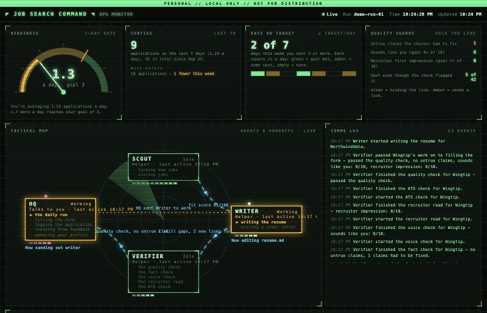
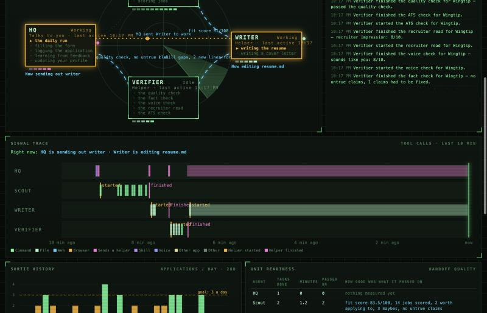
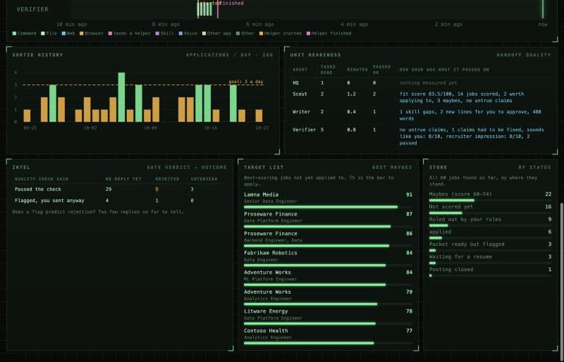

# job-search-agents

A framework for running a careful, truthful job search with [Claude Code](https://claude.com/claude-code).
It finds postings on public employer job boards, scores them against your profile, tailors a resume
from a fact bank of things you have actually done, runs an independent quality gate, and fills
application forms for you to review. You approve every submission.

This repo is the framework only. It ships with a clearly fictional example candidate and a demo
data generator. Your own profile, job database, applications and traces stay in git-ignored folders.



## Architecture

```
            you
             |
        HQ (main session) -- job-search-run, apply-assist, application-tracker,
             |                feedback-learn, profile-intake
             v
          Scout -----------> Writer -----------> Verifier ---------> HQ review queue
   job-discover, job-score   resume-tailor,      quality-gate:        you approve, HQ fills
                             cover-letter        fact-check, humanize, the form, you submit
                                                 recruiter-read, ats-check
                                  ^                    |
                                  +---- flagged -------+
```

- **HQ (main session).** The only part that talks to you. Runs the day, presents the review
  queue, fills approved forms, records outcomes and your feedback.
- **Scout** (`.claude/agents/scout.md`). Polls the watchlist through public Greenhouse, Lever and
  Ashby board APIs, applies your strict exclusions, scores each posting and returns a ranked table.
  Job descriptions stay in its context, not HQ's.
- **Writer** (`.claude/agents/writer.md`). Tailors a resume (and a cover letter when a form asks
  for one) using only `profile/fact-bank.yaml`, in your voice from `profile/voice.md`.
- **Verifier** (`.claude/agents/verifier.md`). Checks a packet it did not write, in a fresh
  context. Four passes with fixed bars:
  - `fact-check`: every claim traces to the fact bank; zero failures allowed.
  - `humanize`: reads like you, not like a model; 8/10 or more.
  - `recruiter-read`: the ten-second skim; 7/10 or more, no unanswered must-have.
  - `ats-check`: builds the DOCX, checks it parses and carries the posting's exact terms.
  Anything below the bar is flagged to you, never sent quietly.
- **Skills** live in `.claude/skills/`; `config/agents.json` maps them to agents.
- **Trace and hooks.** Each skill logs start, end and handoff (with the quality it handed on) via
  `scripts/trace.py`. Claude Code hooks run `scripts/hook_trace.py` on every tool call and
  sub-agent start/stop, logging safe labels only (a command's description, a file's base name, a
  host), never contents or form values. Everything goes to `data/trace.jsonl` on your machine.
- **Monitor.** `scripts/monitor.py` serves a local dashboard on 127.0.0.1: the agent map with live
  handoffs, a per-agent signal trace of tool calls, and KPIs.
- **Weekly KPI review.** `scripts/weekly_report.py` writes `reports/weekly-<date>.md`. The top KPI
  is applications per day against a target, guarded by ranking quality: no fact-check failures and
  no lowering of the gate bars to hit the number.





*Screenshots show fictional demo data from `scripts/demo_data.py`.*

## Setup

Requires Claude Code and Python 3.9+. The scripts use the standard library only; the resume
builder (`scripts/resume_doc.py`) writes DOCX files without extra packages.

1. Clone and copy the example profile, then replace it with your own facts:
   ```bash
   cp -r examples/profile profile
   ```
   Or start Claude Code and say "add this to my fact bank" to run `profile-intake`.
2. Turn on the trace hooks:
   ```bash
   cp .claude/settings.example.json .claude/settings.local.json
   ```
3. Build your watchlist of companies that use Greenhouse, Lever or Ashby, and check each board:
   ```bash
   mkdir -p data && cp examples/watchlist.csv data/watchlist.csv
   ```
   ```bash
   python3 scripts/jobs.py probe greenhouse <board-slug>
   ```
4. Edit `config/discovery.json` (titles, locations, keywords, pay floor) and the KPI target in
   `config/agents.json`. Edit `CLAUDE.md` for any rules of your own.
5. Run the monitor (or use the `monitor` launch config in the Claude desktop app):
   ```bash
   python3 scripts/monitor.py
   ```
   To try it before you have data, fill `data/` with the fictional demo first:
   ```bash
   python3 scripts/demo_data.py
   ```
6. In Claude Code, say "run my job search".

## Using it with Codex or another agent

Nothing here needs Claude Code except the optional per-tool trace hooks. The skills are plain
Markdown procedures and the scripts are standard-library Python.

- [AGENTS.md](AGENTS.md) is the entry point for Codex and other agents: the rules, how to follow
  a skill, and how to run the Scout, Writer and Verifier roles as separate sessions.
- [.claude/skills/README.md](.claude/skills/README.md) indexes every skill in pipeline order,
  with what each reads and writes.
- [scripts/README.md](scripts/README.md) documents every command.

## Principles

- **Truthful.** The fact bank is the only source of claims. Nothing is inferred or inflated; gaps
  become questions for you, not invented bullets.
- **You approve every submission.** The system fills forms and stops. It never creates accounts,
  enters passwords, or gets past a CAPTCHA; those are handed to you.
- **No scraping of sites that forbid it.** Only public employer job-board endpoints, one request
  per company per run, with a pause between companies. No LinkedIn or Indeed automation, no
  stealth or detection evasion.
- **Discreet and local.** Your data never leaves your machine except in the applications you
  choose to send. Legal and demographic answers come only from `profile/preferences.yaml`.

## Credits

Designed and directed by the repository owner: the requirements, the quality bars, the
Scout / Writer / Verifier split, the KPIs and the monitoring approach. Most of the code was written
by Claude Code under that direction.

## License

MIT. See [LICENSE](LICENSE).
